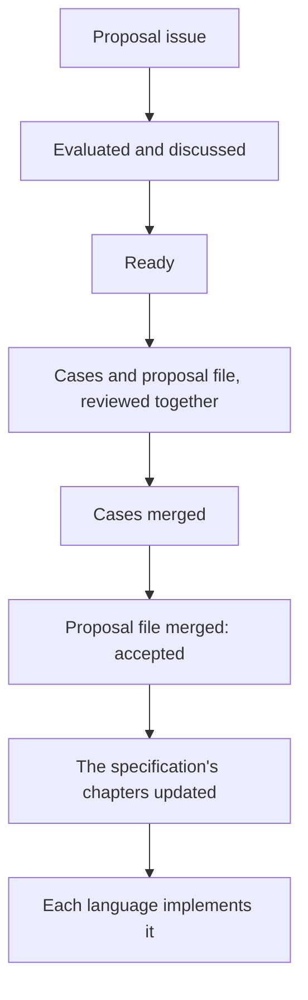

# Contribute

## One issue is all that is asked

If Itinera is missing something you need, [open a proposal issue]({{propose}}) in the specification's repository, saying what you need and why. That is all. Everything after it, from evaluating the proposal to code in every language, is done by the maintainers, with agents, when the proposal is planned, and you can join wherever you like.

A bug in one language's implementation goes to that language's repository, listed on [Languages](/languages/). A problem with this site or the book goes to [the site's issues]({{report-site}}) or [the book's]({{report-book}}).

## How a feature becomes code

What the diagram shows:

1. A feature starts as a proposal issue: why it exists and what is wanted, never specific to a language.
2. It is evaluated and discussed in the issue until nothing is open, and a maintainer marks it ready, or declines or postpones it.
3. Its conformance cases and its proposal file are then written and reviewed together, so a gap in the proposal is found before it is accepted.
4. The cases are merged first. Merging the proposal file is the acceptance, and the specification's chapters are updated with it or right after.
5. Each language then implements it, with a tech spec of its own, and lists it once every case passes.

The whole process, with how proposals are amended, how defects in the specification are handled and how work is merged, is in [PROCESS.md]({{spec}}/blob/{{spec-ref}}/PROCESS.md). Why there are documents at all is explained in [This is not bureaucracy]({{contributing}}#this-is-not-bureaucracy).

## How Itinera is built with AI

Itinera is built mostly by agents, working under a written process: the specification is the source of truth, changes are reviewed by a separate reviewer agent as well as by a maintainer, and conformance is checked in every language. It is built under the terms of [A manifesto for software engineering with AI]({{manifesto}}), and the [contributing guide]({{contributing}}#how-itinera-is-built) says how.

It is also the argument of this site, practised: when a project's rules are written down and its flows are visible, agents can work in it safely.

## Where things are

- [The specification]({{spec}}): proposals, the behaviour specification, the process and the roadmap.
- [The conformance suite]({{conformance}}): the cases every implementation runs.
- [Shared automation]({{actions}}): the checks and release workflows every repository uses.
- [Every repository]({{organisation}}), on GitHub.
