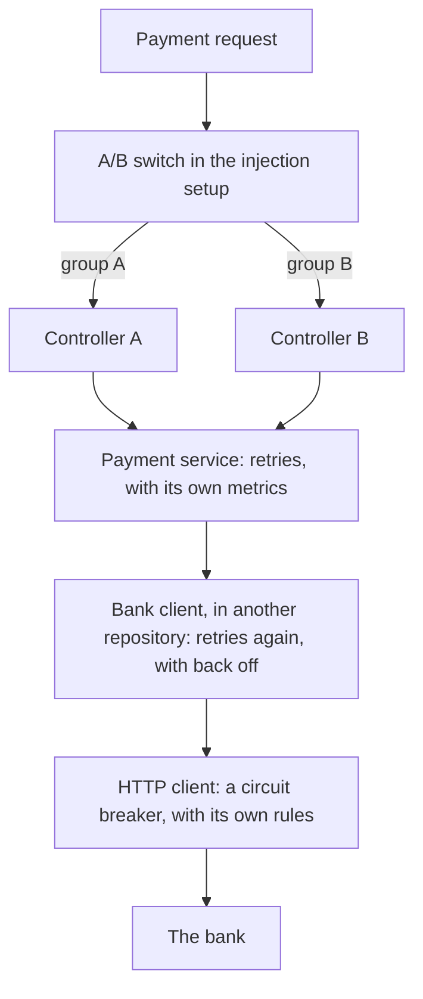
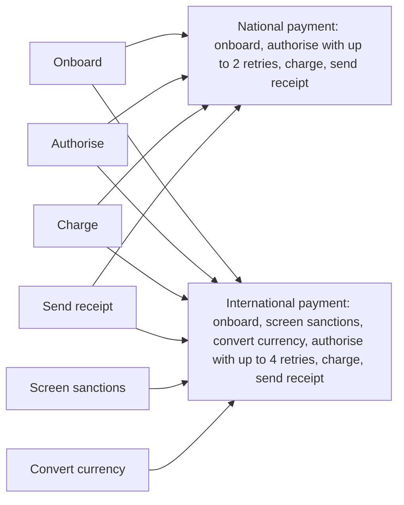
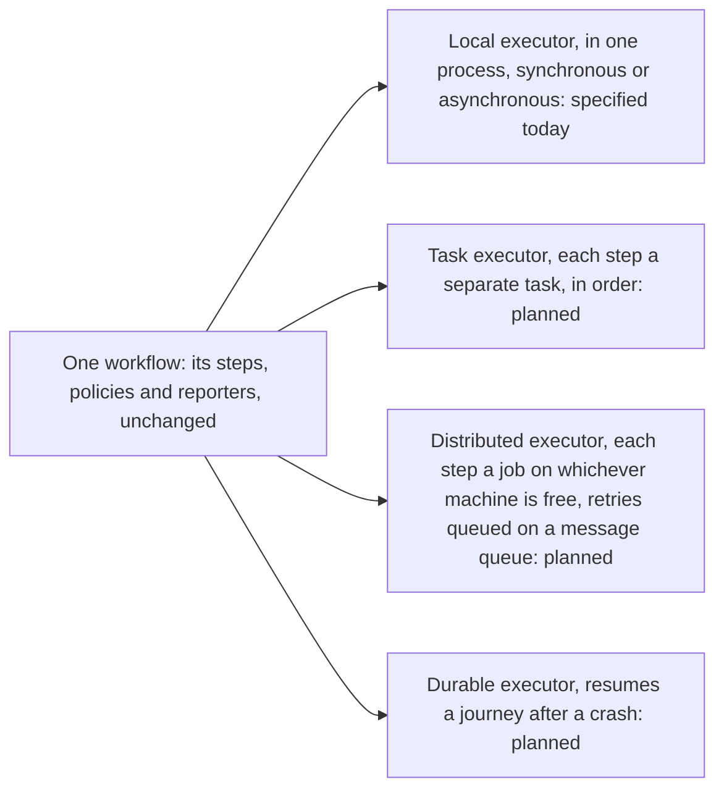

# Separate process from logic. Make agentic code safer.

Know how every request behaves before it runs, whoever wrote the code: your team or its agents.

Itinera is a workflow framework that keeps business rules separate from flow control.

- [Why Itinera](/why/)
- [Read the book](/book/)

<!-- include: status -->

## One question, two answers

Here is one question about a payment system, answered twice: **what happens to a payment when the bank times out?**

### Without Itinera



What the diagram shows:

1. The request first meets an A/B switch hidden in the injection setup, which hands it to controller A or controller B.
2. Both controllers call the payment service, which retries failures and keeps its own metrics.
3. The service calls a bank client kept in another repository, which retries again, with back off.
4. The bank client goes through an HTTP client guarded by a circuit breaker with rules of its own.
5. Only then does the request reach the bank. Nothing on the way records what was decided.

The answer, as a reader has to find it: open the injection setup to learn which controller you get. Open the payment service: it retries, but how many times is in its configuration. Open the bank client, in another repository: it retries again, with back off. Open the HTTP client: a circuit breaker may stop all of it, under rules kept somewhere else. Five places, two teams, and no log to check your answer against.

### With Itinera

The workflow's declaration, four lines:

```rust
#[Workflow(name = "payment", policies = [NotifyCustomer])]
#[Step(Authorise, retry_budget = 2, policies = [CircuitBreaker])]
#[Step(Charge, rescue = RefreshCard)]
#[Step(SendReceipt)]
```

The answer, read off those lines: authorise may be retried twice. Before each retry, the circuit breaker policy decides whether it is still worth trying. That is the whole answer, and it took four lines.

The proof: four of the events of a journey where the bank timed out once.

| Event | Step and attempt | What it says | Decided by |
|---|---|---|---|
| `step_failed` | `authorise`, 1 | the bank timed out; it may be retried | |
| `hook_called` | `authorise`, 1 | circuit breaker, on step retry: no lifecycle, the default stands | |
| `step_retrying` | `authorise`, 1 | try again after a retriable failure | default |
| `step_succeeded` | `authorise`, 2 | | |

Nobody wrote a log line. Every Itinera journey reports this.

### Every flow, read this way

Your team and your agents can read every flow this way.

- [See the whole case](/why/), from the system as it grew to the same system with Itinera.
- [Get started](/book/rust/02-the-big-picture/) in the book: the big picture first, then a workflow you run yourself.

## Vision

<!-- include: vision -->

## Mission

<!-- include: mission -->

## Good practice before agents. A matter of safety now.

Keeping the process apart from the business logic was always good engineering: code that is easier to read, to change and to test. Teams got by without it, because someone remembered how a request really went.

Agents do not remember. They start from nothing every time, change code faster than anyone can review, and can only respect the rules they can see. When the process is scattered across a system, every change risks breaking a rule nobody wrote down, and governance only slows the changes down or gets bypassed.

So separating process from logic is no longer a matter of taste. It is a matter of safety. [The whole story](/why/) tells how a system gets there, and what changes with Itinera.

## The easy way is the isolated way

Isolation is still a discipline: no language can stop a determined developer from reaching outside a step. Itinera makes the disciplined path the shortest one. A step asks for what it needs and is handed it: its inputs by key, the services it uses by key and type, and a place to put what it produces. In Rust, asking is one attribute on a field or a parameter; going to get the same thing yourself is more code, and it stands out in review. People and agents alike take the shortest path, so the shortest path is the isolated one.

## Write a step once, plug it in anywhere

A step knows nothing of the workflow around it, so it plugs into any workflow that needs it, unchanged. A new flow is composed from the steps you already have, and only what is new gets written.

A national and an international payment, for example, share their onboarding, authorisation, charge and receipt. The international one adds two steps of its own:



What the diagram shows:

1. Six steps are written once: onboard, authorise, charge, send receipt, screen sanctions and convert currency.
2. Onboard, authorise, charge and send receipt are plugged into both workflows, unchanged.
3. Screen sanctions and convert currency are plugged into the international payment only.
4. The national payment runs onboard, authorise, charge and send receipt, and allows authorise up to two retries.
5. The international payment runs onboard, screen sanctions, convert currency, authorise, charge and send receipt, and allows authorise up to four retries.

Policies plug in the same way: the circuit breaker is written once and attached to authorise in both workflows. Each workflow declares its own retry budgets, rescue steps and policies, so reusing a step never means inheriting someone else's flow. When a workflow keeps its data under different keys, an input adapter in that workflow hands the step what it asks for, and the step still does not change.

## One workflow, any executor

A workflow does not know how it will be run. The executor decides that: everything in one process, each step as a separate task, each step as a job on whichever machine is free with retries waiting on a message queue, or something else entirely. Steps always run in order, whoever runs them. The steps, the policies and the reporters do not change. Executors differ in what they can do, never in what a workflow means.



What the diagram shows:

1. One workflow, with its steps, policies and reporters, is handed to an executor, and nothing in it changes from one executor to another.
2. The local executor runs a journey in one process, synchronously or asynchronously. It is the one the specification defines today, and the one each language implements first.
3. An executor that runs each step as a separate task, still in order, is planned.
4. An executor that runs each step as its own job on whichever machine is free, with retries queued on a message queue, is planned.
5. A durable executor, which resumes a journey after a crash, is planned.

Today, the specification defines the local executor, and the others are planned. Once your language's release is out, you can build, test and deploy on it with confidence, then hand the same workflow to another executor when you need to, without rewriting it. And once process and logic are separated this way, whether a flow runs in one process or across many machines, much of what microservices are built for, becomes the executor's choice, not something written into every step.

## Workflows that explain themselves

Itinera standardises how flows work, so anyone can understand a flow without opening a single step.

1. **Decisions are declarative.** A step's retry budget, its rescue step, its policies, where its inputs come from and which providers supply its services are declared in the workflow, not coded in the steps.
2. **The declaration can be listed without running anything.** Every workflow can list its steps in order, their policies, input adapters, services and rescue steps.
3. **Mistakes are refused before any journey.** A workflow put together wrongly is refused when it is built or handed to the executor, with every violation listed, before any journey starts.
4. **Reporting is guaranteed.** Every executor produces the same stream of events, with every decision and who made it. Nobody has to decide to log, or remember to emit an event.
5. **Everything is decoupled.** Steps know nothing of the workflow running them, a workflow knows nothing of the executor running it, reporters know only events, and a step never knows which implementation of a service it was given.

## Languages

<!-- include: languages-table -->

[Every language](/languages/), with how to install it and what each release claims.

## One meaning, many languages, proven

The [specification](/specification/) defines what a workflow means, in terms anyone can observe. The conformance suite checks every implementation against it, case by case, and every release carries the report that proves what it claims. [How a release is proven](/releases/).

## What Itinera is not

- Itinera is not a general job queue or message bus.
- Itinera is not a visual process language such as BPMN, although its workflows can be drawn from their definitions.
- Itinera does not offer branching inside a workflow. Branching is moving between workflows, which comes with tier 2 and is planned.

## Built in the open, with AI

Itinera is itself built mostly by agents, under the process it describes: a specification as the source of truth, a proposal for every feature, and conformance checked in every language. It practises what it argues. [How to contribute](/contribute/), and the [manifesto]({{manifesto}}) it is built under.

## Where to go next

1. [The book](/book/), one edition per language, starting at [Get started](/book/rust/02-the-big-picture/).
2. [Why Itinera](/why/): the full story, with a payment system as the case.
3. [The specification]({{spec}}/blob/{{spec-ref}}/spec/README.md) and [VISION.md]({{spec}}/blob/{{spec-ref}}/VISION.md), why Itinera exists.
4. [The conformance suite]({{conformance}}/tree/{{conformance-ref}}) and [what each language claims](/languages/).
5. [How releases are proven](/releases/), from [PROCESS.md]({{spec}}/blob/{{spec-ref}}/PROCESS.md).
6. [The roadmap](/roadmap/): what is there today, and what comes next.
7. [How to propose a feature](/contribute/): one issue is all that is asked.
8. [Each language's repository and API reference](/languages/).
9. [News](/news/) and its [feed](/news/feed.xml).
