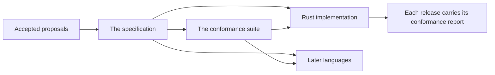

# Specification

Itinera is defined once, by a specification written in plain language, and implemented in each programming language. The specification says what every implementation must do, in terms anyone can observe; the conformance suite checks that each implementation does.

## Three parts, one meaning

What the diagram shows:

1. Every feature starts as a proposal. Once accepted, it is written into the specification.
2. The conformance suite holds cases, written as data, that check the specification's behaviour.
3. Each language's implementation follows the specification and runs the conformance cases.
4. Each release of an implementation carries its conformance report, the proof of what it claims.

## The specification

[The specification]({{spec}}/blob/{{spec-ref}}/spec/README.md) is version {{spec-version}}, tier 1: a single workflow. Its chapters, in reading order:

1. [Concepts]({{spec}}/blob/{{spec-ref}}/spec/01-concepts.md): steps, workflows, policies, hooks, lifecycles, executors, journeys and runs. The single source of Itinera's vocabulary. Read it first.
2. [Events]({{spec}}/blob/{{spec-ref}}/spec/02-events.md): reporters, the event stream and the order of events.
3. [Workflow definitions and configuration errors]({{spec}}/blob/{{spec-ref}}/spec/03-workflow-definitions.md): how a workflow is declared and listed, and the mistakes refused before any journey.
4. [Steps]({{spec}}/blob/{{spec-ref}}/spec/04-steps.md): building a step, its inputs and services, outcomes and contributions.
5. [Running a journey]({{spec}}/blob/{{spec-ref}}/spec/05-running-a-journey.md): the data bag, step statuses, retries, how a journey ends and its result.
6. [Hooks, lifecycles and workflow roles]({{spec}}/blob/{{spec-ref}}/spec/06-hooks-lifecycles-and-roles.md): which hooks run, what they may return, and roles.
7. [Rescue steps]({{spec}}/blob/{{spec-ref}}/spec/07-rescue-steps.md): repairing the cause of a failure before a step runs again.

Why it exists, and what it is not, is in [VISION.md]({{spec}}/blob/{{spec-ref}}/VISION.md).

## The conformance suite

[The conformance suite]({{conformance}}/tree/{{conformance-ref}}) is a set of cases written as data, in Gherkin. Each case builds a workflow, scripts what its steps and hooks do, and checks the result and the event stream. Each language implements a small runner for the cases, once. A language claims a tier only when every case of that tier, and of the tiers before it, passes.

## The implementations

Each language has its own repository, its own book and its own API reference, and lists in its conformance manifest every proposal it implements. [Languages](/languages/) has them all.

## Three rules

1. **The specification comes first.** No implementation is written before its proposal is accepted.
2. **When a proposal and the specification disagree, the specification is right.** Proposals are history; the specification is the current picture.
3. **Nothing in the specification is specific to a language.** How a language implements it is decided in that language's repository.

[PROCESS.md]({{spec}}/blob/{{spec-ref}}/PROCESS.md) has the details.
