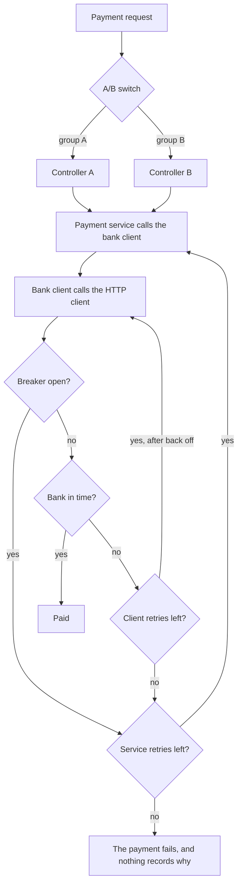
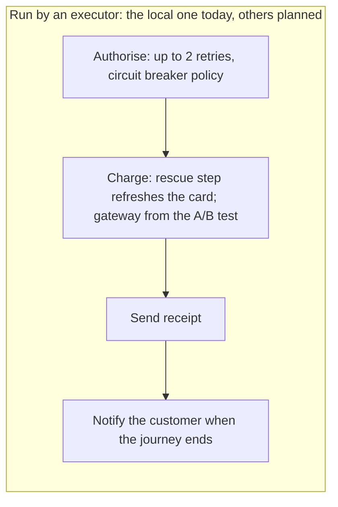
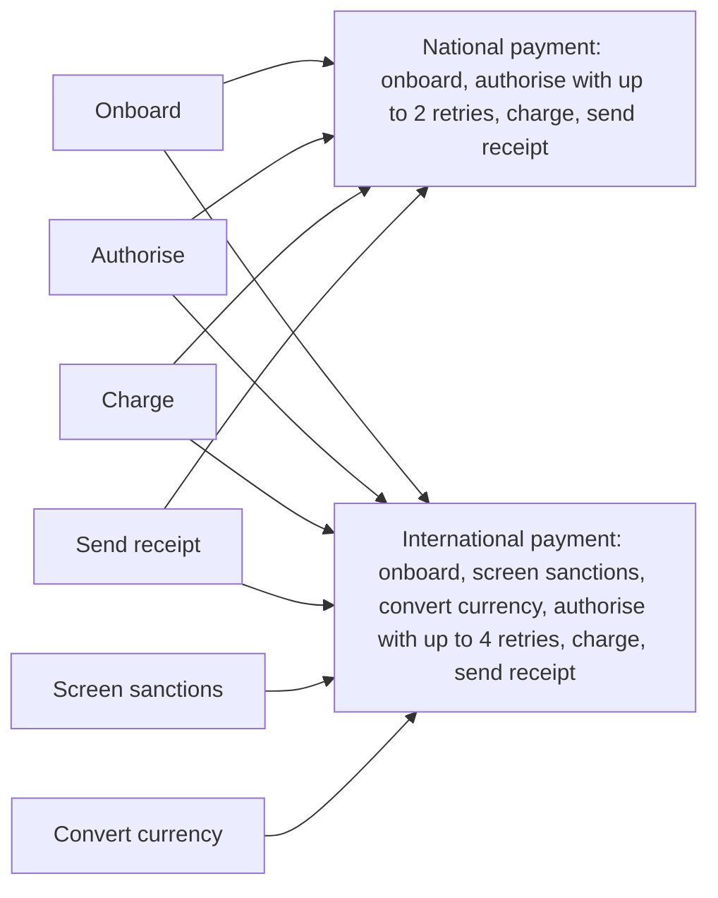
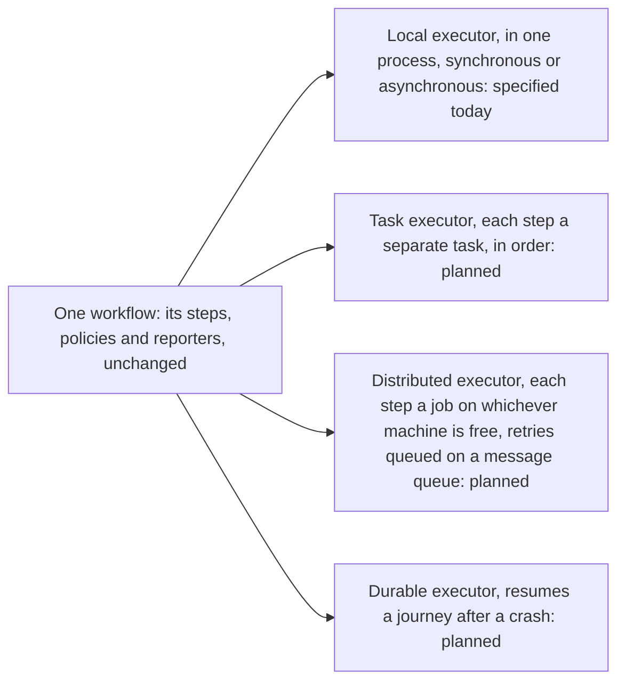

# Why Itinera

Ask anyone who maintains a system that has lived a few years what one request does, every way it can go. Most cannot say without reading a great deal of code, and even then they cannot be sure. This page tells how a system gets there, one reasonable decision at a time, why agents make it worse, and what changes when the process is kept apart from the business logic.

## The system as it grew

A payment system starts clean: controllers, services, entities, repositories and interfaces, each where it belongs. Then it grows. Five changes follow, each made by someone with a good reason, where it was easiest for them.

### An A/B test

The product team wants to try a second payment gateway with some customers. The quickest way is in the injection setup: it hands out controller A to one group and controller B to the other. Nobody reading a controller can tell that a switch decides which one runs.

### A retry, planned properly

The bank sometimes times out, so the payments team plans retries as a whole system, metrics included, and builds it into the payment service. It is good work, and it lives in the service layer.

### Another retry, with back off

A second team needs a slightly different retry, waiting longer between attempts. They own the bank client, in another repository, so that is where it goes. Now a timeout is retried twice over, by rules kept in two places.

### A circuit breaker

When the bank is down, retrying makes things worse, so someone adds a circuit breaker right next to the HTTP client. Its rules reach beyond this system: they can stop every call to the bank, from anywhere.

### Nobody decided to log

Nobody decides to log what was decided, and the teams have no time to talk to each other. Each change is recorded only in the code that made it.

## One request, every way it can go

Nothing in that system is exactly wrong. Yet here is every way a single payment request can go, and this diagram exists only because someone read all of it to draw it.



What the diagram shows:

1. The A/B switch in the injection setup sends the request to controller A or controller B, by group.
2. Either controller calls the payment service, which calls the bank client, which calls the HTTP client.
3. If the circuit breaker is open, the call is refused at once, and it counts as a failure for the payment service.
4. If the breaker is closed and the bank answers in time, the payment is made.
5. If the bank does not answer in time, the bank client waits and retries, while it has retries left.
6. When the bank client has run out, the payment service retries the whole chain, bank client retries included, while it has retries left.
7. When both have run out, the payment fails, and nothing records why.

The two retry systems multiply: if the service makes three attempts and the client makes three for each, a bank that is already struggling gets nine calls. Nobody chose nine. It is every legacy system: it stays manageable because someone remembers, or because the organisation's culture holds the rules, and even that person can get it wrong.

## Now add agents

Agents now write and change much of the code, and they start from nothing every time. Unless they reason deeply enough, they miss the context: the retry in the other repository, the breaker's rules, the switch in the injection setup.

`AGENTS.md` files and similar help for now, when they help at all. In a system where nothing is exactly wrong but nobody knows every rule, changes keep arriving at a speed no person can follow, and soon nobody can keep up with how a single request works.

Governance does not fix it. Restricting pull requests to the main architects is bypassed at best and a bottleneck at worst, and usually both. Keeping the process apart from the logic was good practice before agents. With agents, it is a matter of safety.

## The same system, with Itinera

Itinera changes where each decision lives:

1. **Business rules are all a developer has to care about.** Each one lives in a step that knows nothing of the flow around it, so it is developed, tested and changed on its own, by a person or an agent.
2. **The flow is assembled, in one place.** Whoever owns the process puts steps in order in a workflow, to achieve what the business wants.
3. **Workflows explain themselves.** Anyone opening a workflow sees every step involved, in the order it runs, and every policy attached to it: where each decision is made and who makes it.
4. **What we want to do is separate from how it is done.** The workflow says what; the steps say how. That split is the context an agent needs, given to it directly instead of left for it to rebuild.
5. **Nobody has to decide to log.** Every executor reports the same stream of events, so how a journey went can always be read back, decision by decision.

Here is where each piece of the story lands:

| In the story | With Itinera |
|---|---|
| The A/B test hidden in the injection setup | The gateway a step uses is supplied by a service provider declared in the workflow, for the whole journey or for each attempt, so which variant a journey gets is read in the workflow. Moving a journey to a whole other workflow is tier 2, and planned. |
| The retry system in the service layer | A retry budget on the step, and the decision about each retry in a policy attached in the workflow. Metrics come from the event stream. |
| The other retry, with back off, in another repository | The same place: the step's retry budget and its policies, or a rescue step that fixes the cause before the step runs again. Waiting between attempts, back off, is planned. |
| The circuit breaker beside the HTTP client | A policy attached in the workflow, asking the breaker whether it is open, through a role the workflow provides. Its decisions appear in the event stream, with who made them. |
| Nobody decided to log | Every executor reports the standard event stream; reporters choose where it goes. |
| Reading everything to know one route | Reading one workflow: its steps in order, its policies and its providers. |

### The workflow

The payment, as a workflow. The declaration says everything about the flow:

```rust
#[Workflow(name = "payment", policies = [NotifyCustomer])]
#[Step(Authorise, retry_budget = 2, policies = [CircuitBreaker])]
#[Step(Charge, rescue = RefreshCard)]
#[Step(SendReceipt)]
struct Payment;

// The A/B test: which gateway this journey uses, chosen once for the whole journey.
#[Provider(per_journey, steps = [Charge])]
fn ab_test(journey) -> Gateway { /* gateway A or gateway B */ }
```

A step knows nothing of the flow. It simply asks for what it needs:

```rust
#[Step]
fn charge(#[Input] amount: Money, #[Service] gateway: &Gateway) -> Outcome {
    gateway.take(amount)
}
```

The circuit breaker is a policy. Before each retry, its hook either ends the journey as failed or returns nothing, which lets the retry go ahead:

```rust
#[StepPolicy]
impl CircuitBreaker {
    #[OnStepRetry]
    fn still_worth_it(#[Role] breaker: &Breaker) -> Option<Lifecycle> {
        if breaker.is_open() { Some(FailWorkflow("the bank is down")) } else { None }
    }
}
```

This diagram was drawn from the declaration alone, without opening a step:



What the diagram shows:

1. Authorise runs first. It may be retried twice, and the circuit breaker policy decides whether each retry is still worth it.
2. Charge runs next. If it fails, its rescue step refreshes the card and charge runs once more. Its gateway, A or B, comes from the A/B test provider.
3. Send receipt runs last.
4. When the journey ends, the workflow's policy notifies the customer.
5. An executor runs all of it: the local one today, and the planned ones later, with nothing in the workflow changed.

### What one payment reported

The events of one journey, simplified: contributions and some fields are left out. Every line is reported by the engine on its own; nobody wrote a log statement.

| Number | Event | Step and attempt | What it says | Decided by |
|---|---|---|---|---|
| 1 | `journey_started` | | payment `pay-1042` starts with `order` and `amount` | |
| 2 | `attempt_started` | `authorise`, 1 | | |
| 3 | `step_failed` | `authorise`, 1 | the bank timed out; it may be retried | |
| 4 | `hook_called` | `authorise`, 1 | circuit breaker, on step retry: no lifecycle, the default stands | |
| 5 | `step_retrying` | `authorise`, 1 | try again after a retriable failure | default |
| 6 | `attempt_started` | `authorise`, 2 | | |
| 7 | `step_succeeded` | `authorise`, 2 | | |
| 8 | `attempt_started` | `charge`, 1 | | |
| 9 | `journey_info` | `charge`, 1 | from the A/B test provider: this journey is in group B | |
| 10 | `service_provided` | `charge`, 1 | the gateway, by the A/B test provider | |
| 11 | `step_failed` | `charge`, 1 | the card has expired | |
| 12 | `step_rescuing` | `charge`, 1 | rescue with `charge_rescue` | default |
| 13 | `attempt_started` | `charge_rescue`, 1 | | |
| 14 | `step_succeeded` | `charge_rescue`, 1 | the card was refreshed | |
| 15 | `step_rescued` | `charge`, 1 | `charge` runs again | default |
| 16 | `attempt_started` | `charge`, 2 | | |
| 17 | `step_succeeded` | `charge`, 2 | | |
| 18 | `attempt_started` | `send_receipt`, 1 | | |
| 19 | `step_succeeded` | `send_receipt`, 1 | | |
| 20 | `hook_called` | | notify customer, on workflow success | |
| 21 | `journey_succeeded` | | the payment went through | default |

The story the first diagram hid across five places is here, in order, with who decided each turn. An operator reads it; an agent reads it; a dashboard counts retries from it, which is where the old retry system's metrics now come from.

## One standard for every flow

### The isolated way is the easy way

Isolation is still a discipline: nothing in any language can stop a determined developer from reaching outside a step. Itinera makes the disciplined path the shortest one. A step asks for what it needs and is handed it: its inputs by key, the services it uses by key and type, and a contributor for what it produces. Asking is one attribute on a field or a parameter, such as `#[input]` or `#[service]` in Rust; going to get the same thing yourself is more code, and it stands out in review. People and agents alike take the shortest path, so the shortest path is the isolated one.

### What Itinera standardises

1. **Decisions are declarative.** How many times a step may be retried (its retry budget), whether an abnormal termination may be retried, its rescue step, the policies attached to it, where its inputs come from (its input adapter) and which service providers serve it, for one attempt or the whole journey: all are declared in the workflow, not coded in the steps. There is no workflow-wide default for a retry budget; each step states its own, so the declaration shows everything.
2. **The declaration can be listed without running anything.** The specification requires every workflow to be listable: each step's name and position, its policies in order, its input adapter, the services it requests and the provider serving each, and its rescue step. A workflow literally explains itself.
3. **Mistakes are refused before any journey.** A workflow put together wrongly is refused before any journey, when it is built or handed to the executor, listing every violation. In Rust, several mistakes cannot even be written: they are compile errors.
4. **Reporting is guaranteed.** Every executor produces the same event stream, with every decision and who made it. Nobody has to decide to log, or remember to emit an event.
5. **Everything is decoupled.** Steps know nothing of the workflow running them, and a workflow knows nothing of the executor running it. Reporters know nothing of steps or workflows; they receive events. Services are supplied to steps by the workflow's providers, so a step never knows which implementation it was given. Policies get operations through roles, never data they could hide.

Together, these mean anyone can understand a flow without opening a single step: the steps hold the business rules, and everything about the flow is in the declaration and its policies.

### A step written once, plugged in anywhere

Because a step knows nothing of the workflow around it, it plugs into any workflow that needs it, unchanged, and a new flow is composed from the steps you already have. Say the payment above, with an onboarding step in front, is national, and the business now takes international payments too. They onboard the payer, authorise, charge and send a receipt just the same, and add two steps of their own: screening the payer against sanctions lists, and converting the currency.



What the diagram shows:

1. Six steps are written once: onboard, authorise, charge, send receipt, screen sanctions and convert currency.
2. Onboard, authorise, charge and send receipt are plugged into both workflows, unchanged.
3. Screen sanctions and convert currency are plugged into the international payment only.
4. The national payment runs onboard, authorise, charge and send receipt, and allows authorise up to two retries.
5. The international payment runs onboard, screen sanctions, convert currency, authorise, charge and send receipt, and allows authorise up to four retries.

Both declarations, side by side:

```rust
#[Workflow(name = "national_payment", policies = [NotifyCustomer], providers = [ab_test])]
#[Step(Onboard)]
#[Step(Authorise, retry_budget = 2, policies = [CircuitBreaker])]
#[Step(Charge, rescue = RefreshCard)]
#[Step(SendReceipt)]
struct NationalPayment;

#[Workflow(name = "international_payment", policies = [NotifyCustomer], providers = [international_gateway])]
#[Step(Onboard)]
#[Step(ScreenSanctions)]
#[Step(ConvertCurrency)]
#[Step(Authorise, retry_budget = 4, policies = [CircuitBreaker])]
#[Step(Charge, rescue = RefreshCard, adapter = ConvertedAmount)]
#[Step(SendReceipt)]
struct InternationalPayment;
```

Only `screen_sanctions` and `convert_currency` are new code. `onboard`, `authorise`, `charge` and `send_receipt` are the same steps, and the circuit breaker and the customer notification are the same policies. Each workflow still decides its own flow and its own services: the national payment keeps the A/B test choosing its gateway, the international one serves `charge` an international gateway, and it gives authorise more retries, because a foreign bank fails or times out more often. And `charge` asks for an `amount`, as it always has; in the international payment, the `ConvertedAmount` input adapter, part of that workflow, hands it the converted amount, so the step does not change.

In the system as it grew, reusing the payment service meant reusing its retries, its A/B test and its circuit breaker too, whether the new flow wanted them or not. Here, a step brings only its business rule; everything about the flow stays with the workflow that uses it.

## One workflow, any executor

The workflow says what happens, in what order, and who decides. It does not say how it is run. That is the executor's job, and the executor is chosen when a journey starts, not written into the workflow:



What the diagram shows:

1. One workflow, with its steps, policies and reporters, is handed to an executor, and nothing in it changes from one executor to another.
2. The local executor runs a journey in one process, synchronously or asynchronously. It is the one the specification defines today, and the one each language implements first.
3. An executor that runs each step as a separate task, still in order, is planned.
4. An executor that runs each step as its own job on whichever machine is free, with retries queued on a message queue, is planned.
5. A durable executor, which resumes a journey after a crash, is planned.

The steps, the policies and the reporters are the same under every executor. The specification defines what a workflow means, and every executor must keep that meaning: executors differ in what they can do, never in what a workflow means.

Two things follow:

1. **Start local, move later.** Today, the specification defines the local executor, synchronous and asynchronous, and the others are planned. Once your language's release is out, you can build, test and deploy on it with confidence, adjust the workflow until it behaves as you want, and later hand the same workflow to another executor when the load or the architecture calls for it, without rewriting a step. The one thing to match is the execution mode: a workflow whose steps, hooks, providers or reporters are asynchronous needs an executor that accepts the asynchronous mode, and is refused before any journey otherwise.
2. **Where steps run becomes the executor's choice.** Much of what microservices try to buy is the freedom to run parts of a flow in different places. Once process and logic are separated this way, where each step runs, in one process or across many machines, is decided by the executor, not written into every step. Splitting a flow across machines, or bringing it back together, stops being a rewrite.

## The one rule left

Itinera makes isolation easy, not impossible to break. A step can still loop and retry inside itself, or call an HTTP client with retries and a circuit breaker of its own. What remains is one rule that anyone, a person, an agent or a reviewer, can check: **a step decides nothing about the flow.**

The workflow shows at a glance which policies are attached to which steps, and a hook can only choose from a short, fixed list of what may happen next. What a policy decides still takes reading the policy, which is small and in one place. So the promise is every decision in one place, not no reading at all. One rule that is easy to check, and made the easy path, beats many rules that someone has to remember.

## Starting from the system you have

You do not rewrite a system to adopt Itinera. Take one route at a time:

1. Pick a route whose behaviour nobody can state with confidence, such as the payment above.
2. Wrap the existing services it calls as steps, as they are.
3. Move their retries, fallbacks and breakers out of the code and into the workflow: retry budgets on the steps, decisions in policies, repairs in rescue steps.
4. Point a reporter at the event stream, and read what the route actually does.

The book walks through it with a worked example, in [From tangled code to a workflow](/book/rust/26-from-tangled-code-to-a-workflow/).

## What is there today

Itinera's first tier, a single workflow, is specified. <!-- include: implementations --> [Languages](/languages/) says exactly where each language stands. Some parts of the story above are planned, not there yet:

- **Back off**, waiting between attempts, is planned.
- **Moving a journey to another workflow**, such as an A/B test between whole flows, is tier 2, and planned.
- **Durable runs**, journeys that can resume after a crash, come in a later tier.
- **Executors other than the local one**, such as running steps as tasks or across machines, are planned.

The [roadmap](/roadmap/) has the order.

## Next

- [Quick start](/book/rust/quick-start/), in the book: a workflow you run yourself.
- [Languages](/languages/): what you can install today.
